# Yokai Kanji

[](https://kiroween.devpost.com)
[](https://kiroween.devpost.com)
[](LICENSE)
[](package.json)

<p align="center">
  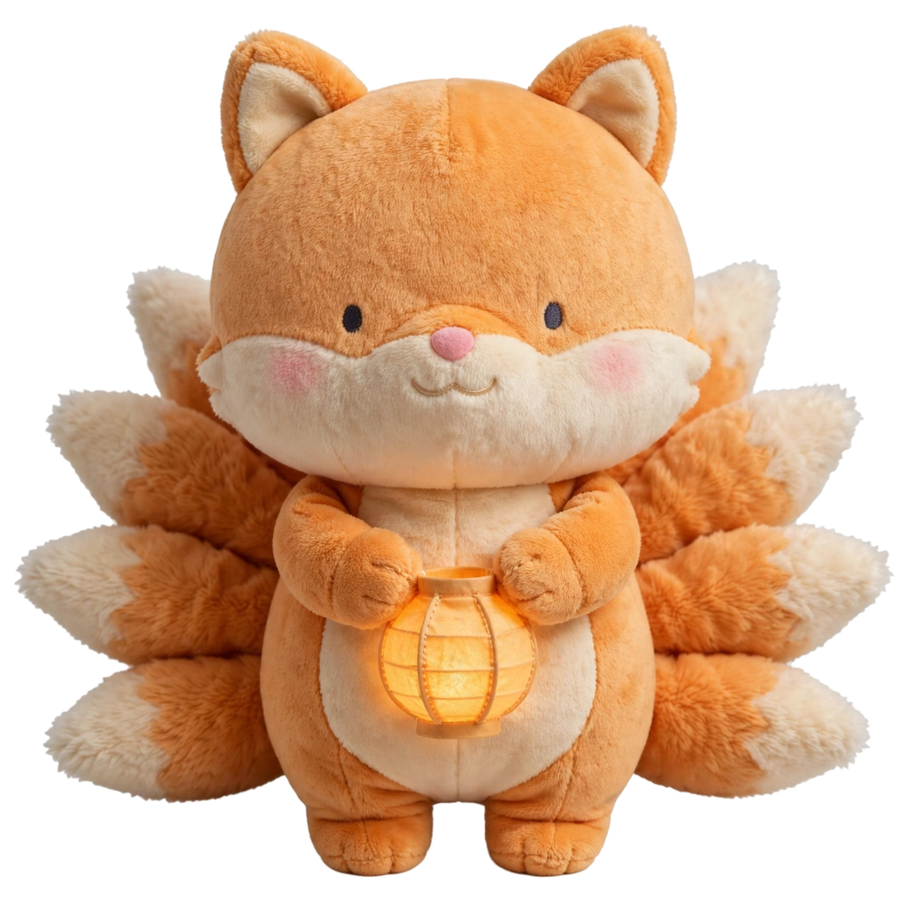
</p>

<p align="center">
  <b>Learn JLPT N5 kanji in a haunted Japanese night.</b><br>
  Answer quizzes, light lanterns, defeat the Oni, and meet seven yokai.
</p>

<p align="center">
  Built for <a href="https://kiroween.devpost.com">Kiroween 2026</a>, Costume Contest category.
</p>

## What is it

Yokai Kanji is a web game for learning JLPT N5 kanji. There are no accounts and no leaderboard, just you, 50 kanji, and a night full of yokai. Correct answers light lanterns and earn XP. Wrong answers come back for review. Answer 10 in a row to meet the next yokai.

## Game modes

**Meaning quiz.** See a kanji, pick the correct English meaning.

**Reading quiz.** See a kanji, pick the correct hiragana reading.

**Boss Battle Oni.** The Oni has 100 HP. Each correct answer deals 20 damage, so five hits win the battle. Each wrong answer costs one of your three lanterns. Win to earn a 50 XP boss bonus and meet the next yokai.

**Memory Match Ofuda.** Flip 12 cards and pair each kanji with its meaning. Match all 6 pairs to earn 30 XP.

**Learning path.** Ten stations of five kanji each, in a zigzag path down the home screen. A station is done when all five of its kanji are mastered, and a different yokai guides each station.

**Daily quests.** Three quests every day: answer 10 questions, earn 50 XP, and keep your streak.

**Light SRS.** Wrong answers return later in the same session, and mastered kanji feed the learning path and the daily quests.

## Meet the yokai

Seven yokai have portraits. The rest show their kanji until you meet them.

<table>
  <tr>
    <td align="center"><br><b>Kitsune</b><br><i>A clever fox spirit who can change shape.</i></td>
    <td align="center">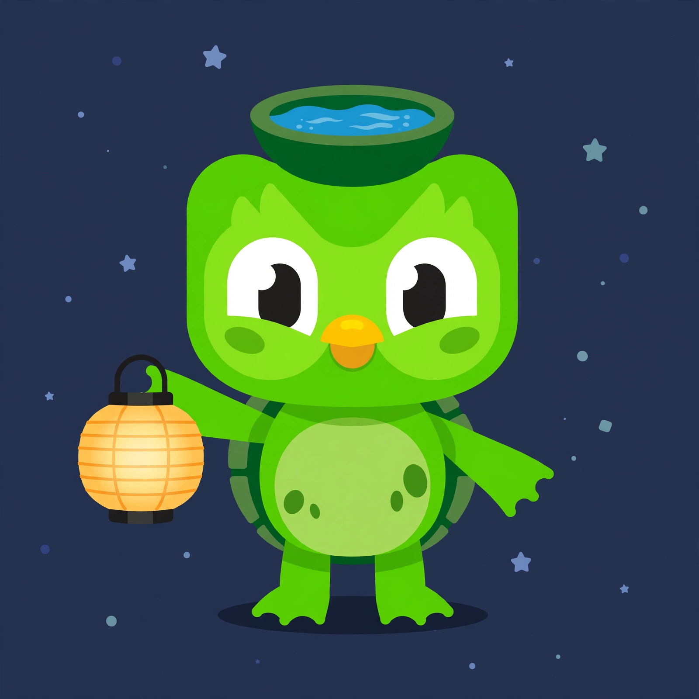<br><b>Kappa</b><br><i>A river spirit who loves cucumbers and sumo.</i></td>
    <td align="center">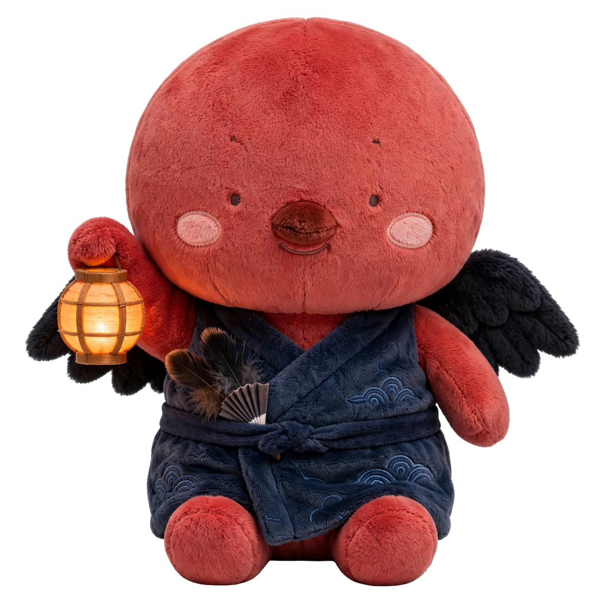<br><b>Tengu</b><br><i>A mountain guardian with a long nose and strong winds.</i></td>
    <td align="center">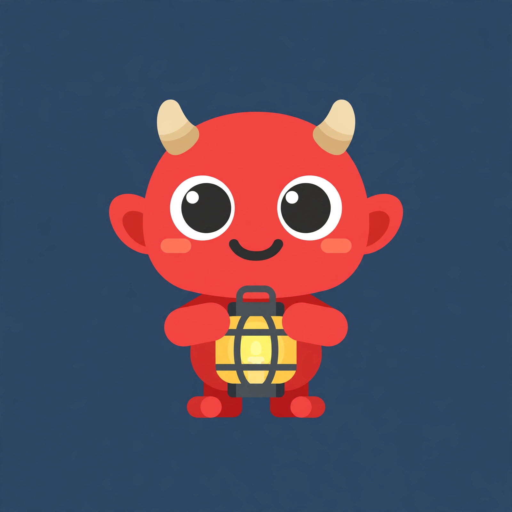<br><b>Oni</b><br><i>A strong demon with horns and a loud laugh.</i></td>
  </tr>
  <tr>
    <td align="center">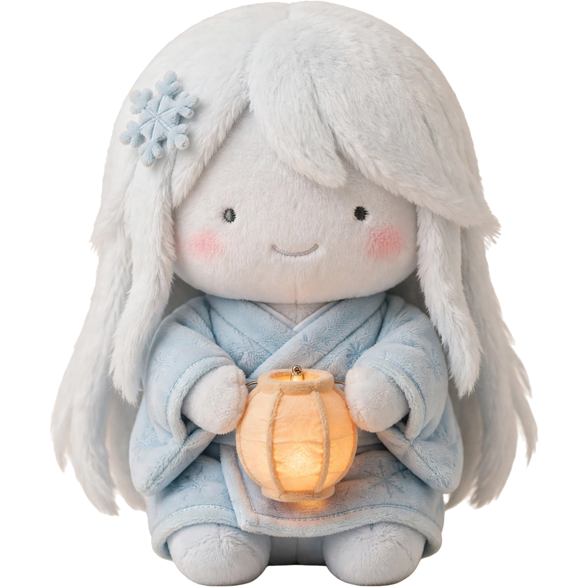<br><b>Yuki-onna</b><br><i>A snow woman who appears on cold winter nights.</i></td>
    <td align="center">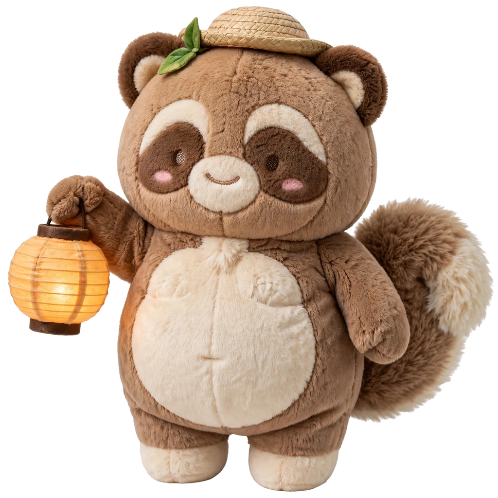<br><b>Tanuki</b><br><i>A playful raccoon dog who loves tricks and sake.</i></td>
    <td align="center">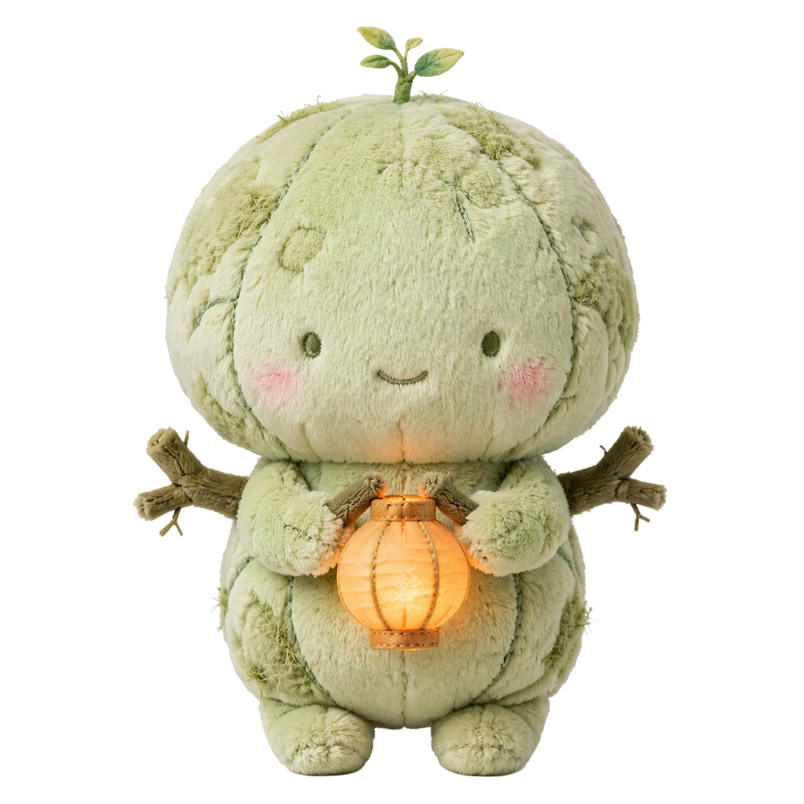<br><b>Kodama</b><br><i>A quiet tree spirit who guards the forest.</i></td>
    <td align="center"><br><b>29 more to meet</b><br><i>Amaterasu, Tsukuyomi, Baku, Raijin, and more are waiting in the collection.</i></td>
  </tr>
</table>

All seven mascots are original yuru-chara plush characters in the same style: soft stuffed fabric, dot eyes, pink blush cheeks, and a small glowing amber paper lantern.

## Screenshots

<table>
  <tr>
    <td>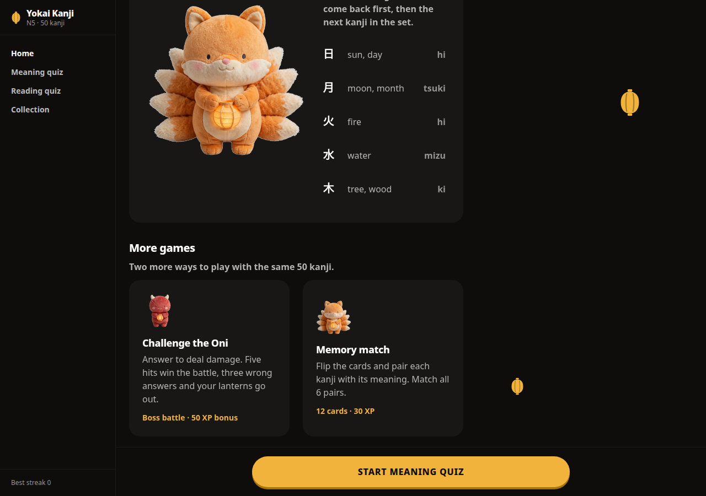<br><b>Home.</b> Kitsune guides you, the learning path zigzags below, and Boss Battle and Memory Match wait in the More games section.</td>
    <td>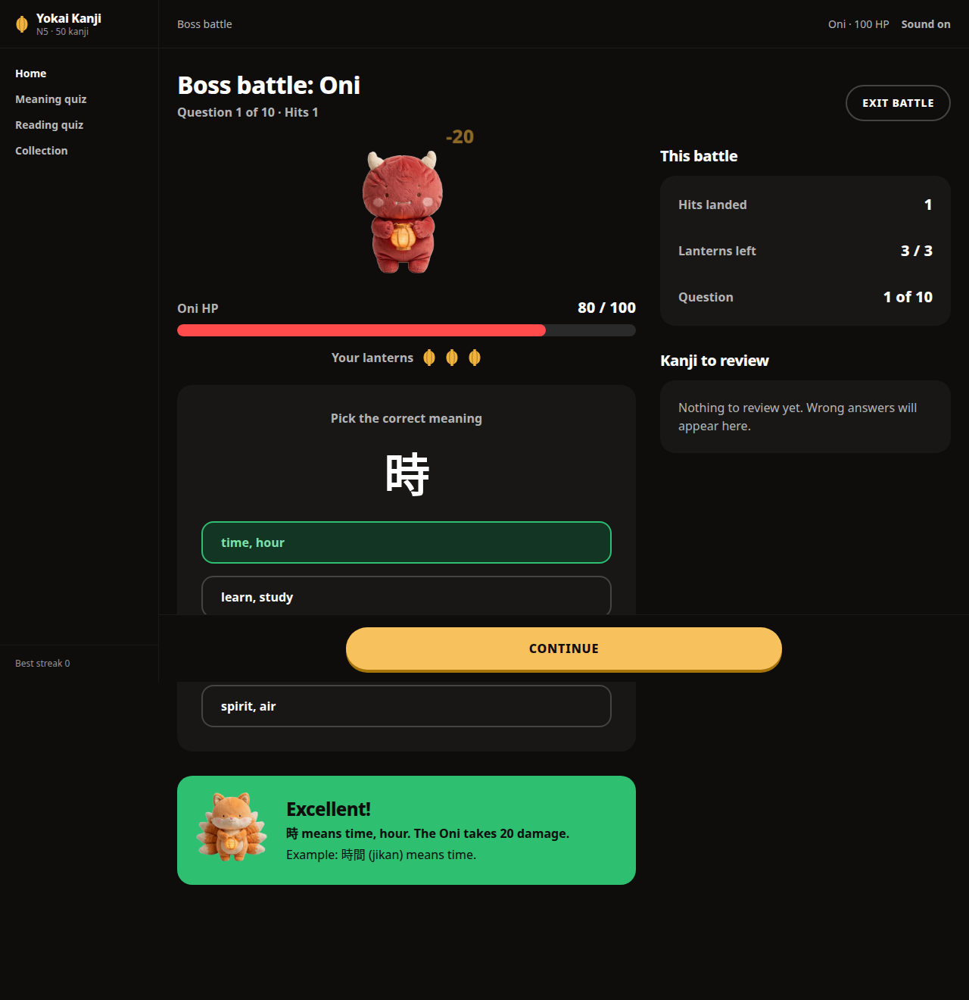<br><b>Boss Battle.</b> The Oni takes 20 damage per correct answer. Three lanterns stand between you and defeat.</td>
  </tr>
  <tr>
    <td>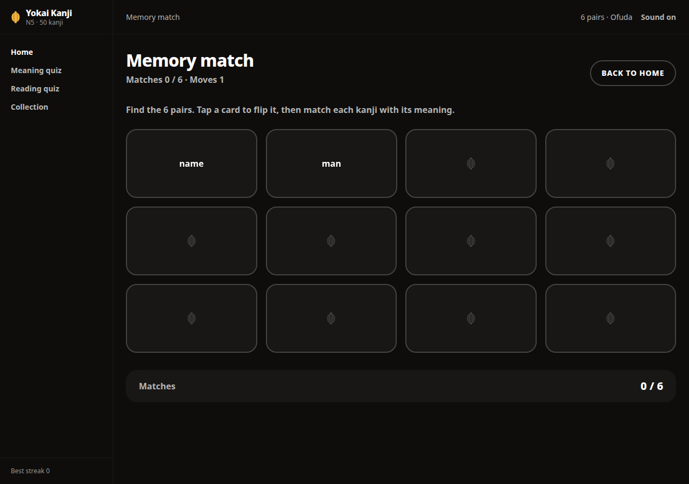<br><b>Memory Match.</b> Twelve cards, six pairs of kanji and meaning. Matched pairs reveal their yokai.</td>
    <td>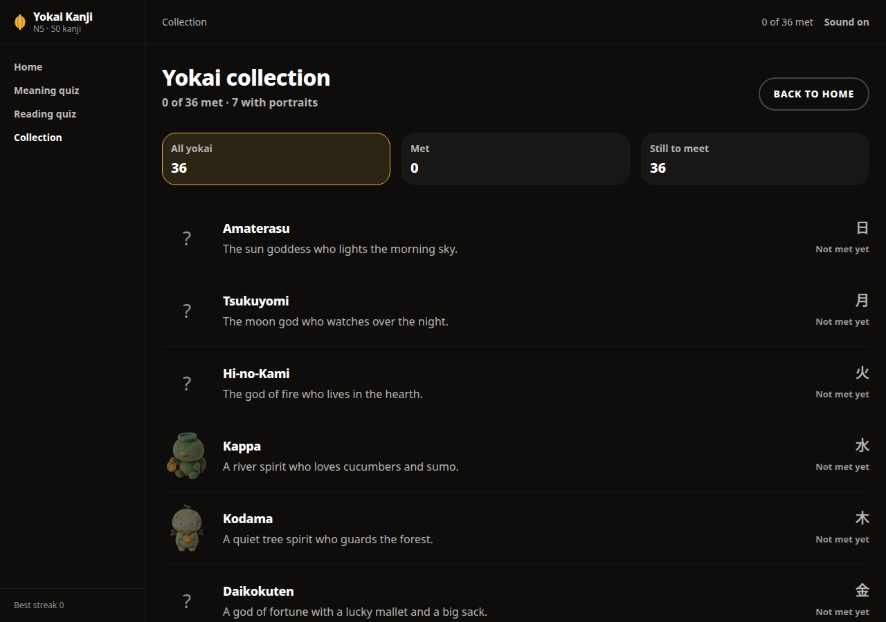<br><b>Collection.</b> 36 yokai in total, 7 with portraits. Meet them one by one and watch the count grow.</td>
  </tr>
</table>

## How to play

1. Open the home screen and press Start Meaning Quiz.
2. Pick an answer, press Check, read the feedback, then press Continue.
3. Correct answers earn 10 XP and light a lantern. Wrong answers return later in the session.
4. Answer 10 in a row to meet the next yokai in the collection.
5. Try Boss Battle when you want a fight, and Memory Match when you want a calmer game.
6. Come back tomorrow to keep your streak and finish the new daily quests.

## Tech stack

Vite, React, TypeScript, and Tailwind CSS. No backend, no database, no accounts. Progress lives in LocalStorage. Sounds are synthesized with WebAudio, so there are no audio files. Mascots are transparent PNGs in `public/mascots/`.

## Run locally

```bash
npm install
npm run dev
```

Open the URL shown in the terminal, usually http://localhost:5173

## Build

```bash
npm run build
npm run preview
```

## Project structure

```text
.kiro/                  Kiro steering and specs (product, tech, structure, requirements, design, tasks)
public/mascots/         The seven yokai portraits, transparent PNG
src/data/kanji-n5.json  50 verified N5 kanji with meaning, readings, example, and yokai
src/lib/                storage, SRS, yokai stories and portraits, sound
src/pages/              Home, Quiz, Collection, Boss, Match
src/components/         QuizCard, YokaiRow, LanternProgress, DemoPlayer
remotion/               Demo video composition, 75 seconds, 1920 by 1080
docs/screenshots/       Screenshots used in this README
```

## Built with Kiro

This project was built with Kiro using spec driven development. The spec lives in `.kiro/specs/yokai-kanji/` and covers requirements, design, and tasks, and the steering files in `.kiro/steering/` record the product, tech, and structure decisions. Kiro generated the scaffold, the quiz engine, the SRS logic, the learning path, the daily quests, the Boss Battle and Memory Match modes, and the Remotion demo composition from those specs.

## Demo video

A 75 second demo video is built with Remotion, not a screen recording. The composition is `YokaiKanjiDemo` in `remotion/`, with an intro, a sample quiz, the yokai collection, and a closing scene. Preview it in the studio or render it:

```bash
npm run studio
npm run render:demo
```

The render writes `out/yokai-kanji-demo.mp4` and needs a local Chrome or Chrome Headless Shell. The demo stays under 3 minutes, as required for the Devpost submission.

## Project status

In scope for Kiroween 2026: 50 N5 kanji, meaning quiz, reading quiz, Boss Battle, Memory Match, learning path, daily quests, light SRS, XP and streak, and a 36 yokai collection with 7 portraits.

Out of scope for this version: accounts, online leaderboard, stroke writing, N4, and portraits for the remaining 29 yokai.

## License

MIT. See LICENSE.

Built by Anatraen, with Muse.
